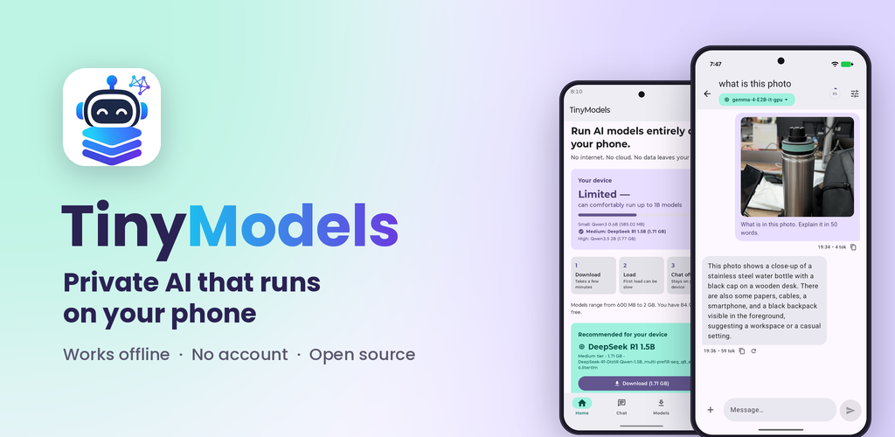
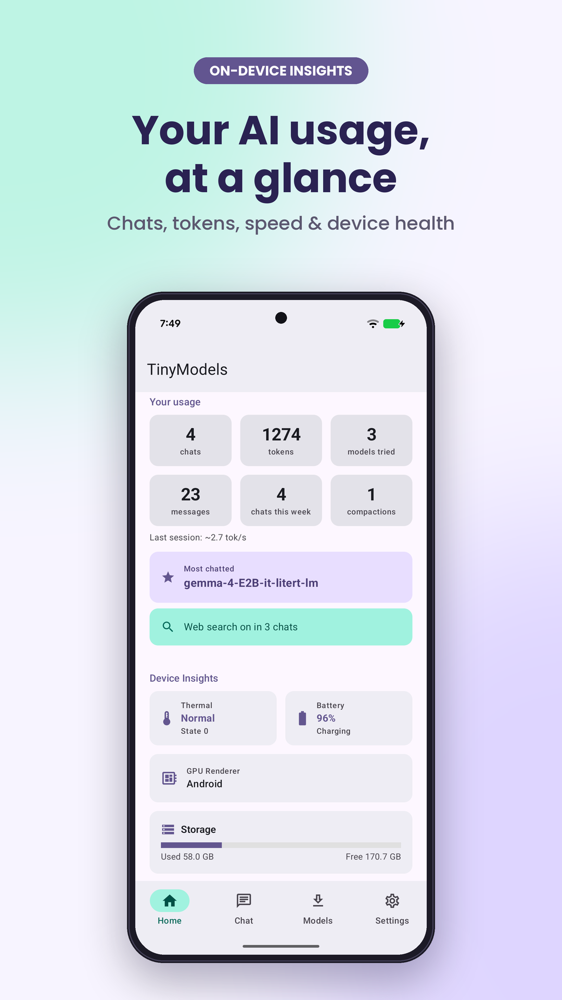
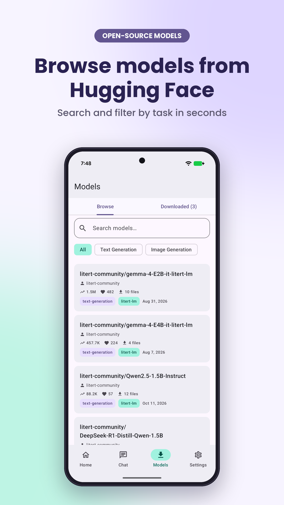
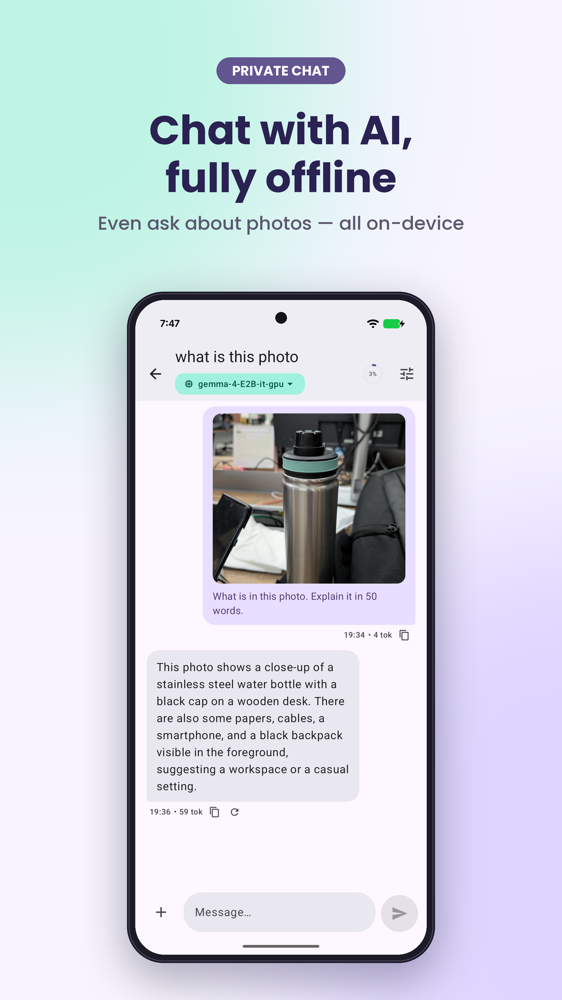
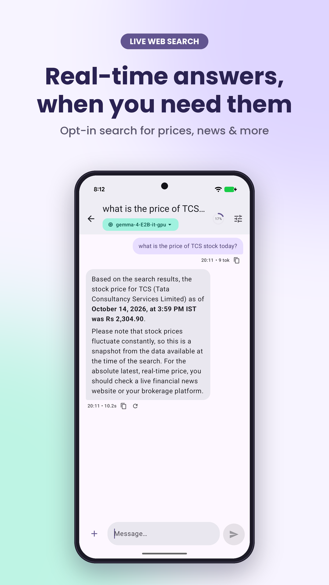

<p align="center">
  
</p>

<h1 align="center">TinyModels</h1>

<p align="center">
  <b>Run AI models entirely on your Android phone.</b><br>
  Private, offline-first, and built for real on-device use.
</p>

<p align="center">
  <a href="https://play.google.com/store/apps/details?id=com.ai.tinymodels">
    
  </a>
  <a href="https://www.phonepeappstore.com/apps/productivity/tinymodels/com.ai.tinymodels/?page=details&id=com.ai.tinymodels">
    
  </a>
  <a href="https://apkpure.com/p/com.ai.tinymodels">
    
  </a>
  <a href="https://github.com/vengateshk18/TinyModels/releases/latest">
    
  </a>
</p>

<p align="center">
  
  
  
  
  
</p>

<p align="center">
  <a href="https://vengateshk18.github.io/TinyModels/"><b>Website</b></a> ·
  <a href="https://github.com/vengateshk18/TinyModels/issues">Issues</a> ·
  <a href="CONTRIBUTING.md">Contributing</a>
</p>

---

TinyModels is an open-source Android app for running language models directly on your phone. Browse models, download or import them, chat privately, ask about photos, use optional web search, and benchmark performance — all with a privacy-first, on-device experience.

## ✨ What’s in the app today

| | Feature | What it does |
|---|---|---|
| 🔎 | **Model catalog** | Browse Hugging Face models, inspect files, check device fit, and pick the right model for your phone. |
| 📦 | **LiteRT-LM + GGUF support** | Run both `.litertlm` and `.gguf` models in one app. |
| 💬 | **Private chat** | Stream responses token by token with Markdown rendering, chat history, regenerate/edit/stop controls, and draft safety. |
| 📷 | **Camera + photo vision** | Capture a photo with the camera or attach one from gallery and ask vision-capable models about it on-device. |
| 🌐 | **Web search on your terms** | Enable web search per chat or turn on global always-search in Settings. Search stays off by default. |
| 📊 | **Benchmark** | Measure load time, time to first token, tokens/sec, and peak memory with a repeatable on-device benchmark. |
| 🎨 | **Custom themes & personalization** | Choose themes, appearance options, fonts, and app language to make TinyModels feel yours. |
| 🧩 | **Widget, storage & settings** | Add a home screen widget, view storage/model controls, and manage app behavior from a clean Settings experience. |
| 🌍 | **6 languages supported** | English, Tamil, Hindi, Spanish, Japanese, and French are available in the current release. |

## 📱 Screenshots

<p align="center">
  
  
  
  
</p>

## 🚀 Getting started

1. **Install TinyModels** from [Google Play](https://play.google.com/store/apps/details?id=com.ai.tinymodels), [PhonePe App Store](https://www.phonepeappstore.com/apps/productivity/tinymodels/com.ai.tinymodels/?page=details&id=com.ai.tinymodels), [APKPure](https://apkpure.com/p/com.ai.tinymodels), or [GitHub Releases](https://github.com/vengateshk18/TinyModels/releases/latest).
2. **Browse or import a model** — choose a LiteRT-LM or GGUF model that fits your device.
3. **Download and chat** — run inference fully on-device.
4. **Customize it** — adjust themes, widget, storage, language, and web search settings the way you like.

> **Tip:** Start with a small model if you’re on a 4–6 GB RAM device. Larger models work best on higher-memory phones.

## 🧭 Roadmap

What’s coming next:

- **RAG / Document chat** — upload documents and chat with your files using on-device retrieval.
- **Human + model games** — playful duo experiences like XO, where you and the model take turns.
- **More tools & skills** — richer tool/skill capabilities so users can do more through natural conversation.
- **More languages** — German and Russian are planned next.

## 🏗️ How TinyModels is developed

TinyModels is built as a modern Android app with a local-first architecture:

- **Language/UI:** Kotlin, Jetpack Compose, Material 3
- **Architecture:** feature-first structure with ViewModel + repository layers
- **On-device inference:** LiteRT-LM runtime and GGUF runtime
- **Local data:** Room for chats/history and DataStore for app settings
- **Background work:** WorkManager for reliable downloads/import-related tasks
- **Networking:** Retrofit/OkHttp for model catalog and optional web search
- **Image & media:** camera capture via Android camera intents/FileProvider and on-device image processing
- **Quality:** JVM unit tests for logic, feature behavior, and regressions

The product direction is simple: make powerful local AI useful, private, and approachable on everyday Android devices.

## 🛠️ Build from source

**Prerequisites:** Android Studio (recent), JDK 17, Android SDK 37, and an arm64 Android device or emulator with at least 4 GB RAM.

```bash
git clone https://github.com/vengateshk18/TinyModels.git
cd TinyModels
./gradlew :app:assembleDebug      # build debug APK
./gradlew :app:testDebugUnitTest  # run JVM unit tests
```

Install `app/build/outputs/apk/debug/app-debug.apk`, open the app, download a model that fits your device, and start chatting.

## 🔒 Privacy

Chats, photos, and models stay on your device. TinyModels has no accounts and no analytics SDKs.

Web search is optional: it only contacts the network when you enable it (per chat or global always-search setting). When enabled, search queries and opened page content are fetched through the configured web search flow.

Full details: [Privacy Policy](https://vengateshk18.github.io/TinyModels/privacy.html) · [Security](https://vengateshk18.github.io/TinyModels/security.html)

## 🤝 Contributing

Contributions are welcome — bug fixes, features, docs, and tests.

- Read [CONTRIBUTING.md](CONTRIBUTING.md)
- Follow the [Code of Conduct](CODE_OF_CONDUCT.md)
- Open an [issue](https://github.com/vengateshk18/TinyModels/issues) for bugs or feature requests

## 📄 License

MIT — see [LICENSE](LICENSE).

<p align="center"><sub>Built for private, local AI on Android. If TinyModels is useful, a ⭐ on GitHub is appreciated.</sub></p>
