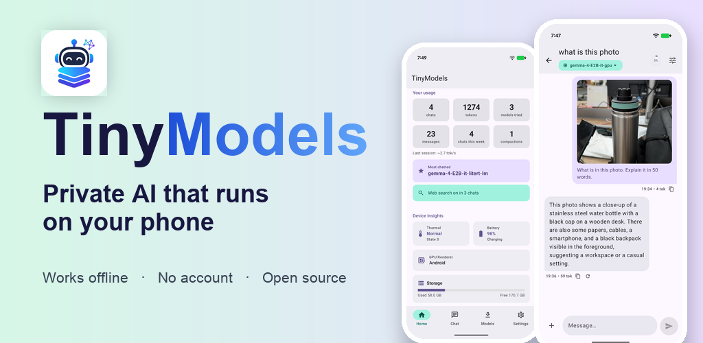

<p align="center">
  
</p>

<h1 align="center">TinyModels</h1>

<p align="center">
  <b>Run AI models entirely on your Android phone.</b><br>
  No internet. No account. No data leaves your device.
</p>

<p align="center">
  <a href="https://www.phonepeappstore.com/apps/productivity/tinymodels/com.ai.tinymodels/?page=details&id=com.ai.tinymodels">
    
  </a>
  <a href="https://apkpure.com/p/com.ai.tinymodels">
    
  </a>
  <a href="https://github.com/vengateshk18/TinyModels/releases/latest">
    
  </a>
</p>

<p align="center">
  
  
  
</p>

TinyModels is a free, open-source Android app that brings small open language models
onto your phone. Browse the catalog, download a model once, and chat — inference runs
locally through Google's **LiteRT-LM** runtime. Your prompts, photos, and conversations
stay on your device; the optional web-search tool is off by default.

---

## 📲 Download

| Store | Get TinyModels |
| :--- | :--- |
| **PhonePe App Store** | [TinyModels — Productivity](https://www.phonepeappstore.com/apps/productivity/tinymodels/com.ai.tinymodels/?page=details&id=com.ai.tinymodels) |
| **APKPure** | [TinyModels APK](https://apkpure.com/p/com.ai.tinymodels) |
| **GitHub Releases** | [Latest release](https://github.com/vengateshk18/TinyModels/releases/latest) |

> **Requirements:** Android 8.0 or newer · arm64 device · 4 GB RAM minimum
> (8 GB+ recommended for 3B models).

## ✨ Why TinyModels?

- **Private by default** — no account, no analytics SDKs, and no server-side inference.
- **Works fully offline** — download a model once and keep using it in airplane mode.
- **Made for real phones** — device capability checks recommend models that fit your RAM.
- **Open source** — MIT licensed. Read the code, build it yourself, or contribute.

## 🚀 Features

| | Feature | What you get |
| :--: | :--- | :--- |
| 🗂️ | **Model catalog** | Search and filter Hugging Face LiteRT-LM models, inspect per-file details (size, quantization, context window), and see what fits your device before downloading. |
| ⬇️ | **Reliable downloads** | Resumable WorkManager downloads with progress notifications, cancel/retry, Wi-Fi-only mode, and storage checks before a model starts downloading. |
| 🔄 | **Import & export** | Import `.litertlm` files from storage or export downloaded models to share between devices — all through the system file picker, with no storage permission required. |
| 💬 | **On-device chat** | Token-by-token streaming with Markdown bubbles, persisted conversations, regenerate/edit, per-chat sampler settings, and a live context-usage gauge. Stop generation or queue your next prompt at any time. |
| 🖼️ | **Vision** | Attach a photo on vision-capable models and ask about it. The image is processed on-device and never uploaded. |
| 🌐 | **Web search (opt-in)** | Enable a per-chat tool when the model needs current information. It is disabled by default. |
| 🧠 | **Context management** | True context-window detection, automatic compaction at 90% usage, and a manual Compact action for long conversations. |
| ⚡ | **Benchmarks** | Measure load time, time-to-first-token, tokens per second, and peak memory for the model on your phone. |
| 📊 | **Device insights** | A home dashboard with usage stats, AI-capability scoring, RAM guidance, and storage overview. |
| 🎨 | **Personalisation** | Light/dark theme, font size, CPU/GPU/Auto backend, Wi-Fi-only downloads, and a Hugging Face token for gated models. |

## 🧠 How it works

1. **Pick a model** that suits your phone's RAM and the task.
2. **Download it once** — downloads resume automatically if the connection drops.
3. **Chat locally** — LiteRT-LM runs inference on the phone's CPU or GPU. No network is
   needed after the model is downloaded.

## 🛠️ Tech stack

| Area | Technology |
| :--- | :--- |
| **UI** | Kotlin, Jetpack Compose, Material 3 |
| **Architecture** | MVI with immutable `UiState` per screen |
| **Dependency injection** | Hilt |
| **Persistence** | Room, DataStore |
| **Background work** | WorkManager, Coroutines/Flow |
| **Inference** | LiteRT-LM (CPU / GPU / Auto) |
| **Model catalog** | Hugging Face Hub API |

## 🗂️ Project structure

```text
app/src/main/java/com/ai/tinymodels/
├── core/      # inference, database, network, shared UI
├── data/      # repositories and data sources
├── domain/    # domain models and use cases
├── feature/   # home, models, chat, benchmark, settings
└── di/        # Hilt modules
```

## 🏗️ Build from source

**Prerequisites:** Android Studio (recent), JDK 17, Android SDK 37, and an arm64 device
or emulator with at least 4 GB RAM.

```bash
git clone https://github.com/vengateshk18/TinyModels.git
cd TinyModels
./gradlew :app:assembleDebug      # build
./gradlew :app:testDebugUnitTest  # unit tests
```

Install `app/build/outputs/apk/debug/app-debug.apk`, open the app, download a
Small-tier model from Home, and say hello. Large models (3B+) need 8 GB+ RAM devices.

## 🔒 Privacy

Chats, photos, and models stay on your device. TinyModels has no accounts and no
analytics SDKs. Web search is the only feature that contacts the network, and only
when you explicitly enable it for a chat.

Full details: [Privacy Policy](https://vengateshk18.github.io/TinyModels/privacy.html) ·
[Security](https://vengateshk18.github.io/TinyModels/security.html).

## 🤝 Contributing

**Yes — this app is open for contributions!** Bug fixes, new features, docs, and tests
are all welcome. Please read [CONTRIBUTING.md](CONTRIBUTING.md) first (setup, branch
naming, PR checklist), and note our [Code of Conduct](CODE_OF_CONDUCT.md).

Quick links: [open issues](../../issues) · [bug report](../../issues/new?template=bug_report.md) ·
[feature request](../../issues/new?template=feature_request.md)

## 📄 License

MIT — see [LICENSE](LICENSE).

<p align="center"><sub>Built with ❤️ for private, local AI on Android. If TinyModels is useful, a ⭐ on GitHub is appreciated.</sub></p>
